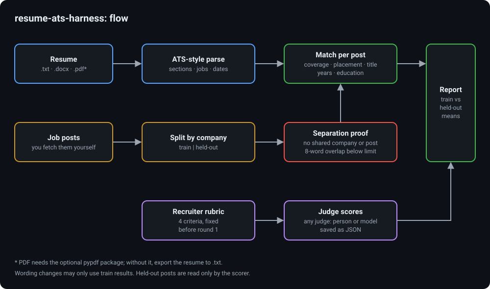

# resume-ats-harness

A test harness for resumes. It reads a resume the way applicant tracking software does, scores skill
coverage and keyword placement against job posts, keeps a training / held-out split of posts by company with
a separation proof, and holds a fixed recruiter-judge rubric with score aggregation. Python standard library
only; no network calls and no API calls.

Used on: my own resume. A fuller private version (four PDF extractors plus a port of OpenResume's
parser, and a local-model semantic match) took the parse score across those 5 parsers from 85.6% to 100%,
and scored the match on 53 public job posts split by company into 31 training and 22 held-out posts.

Author: Kamal Mehta · [kamal-mehta.com](https://kamal-mehta.com/?r=github)



## Why

Tuning a resume against the same posts you score it on finds wording that fits those posts, not wording
that works. The fix is the one used for any model: hold some posts out. Here the split is by company, so a
company's style never leaks from the training side into the held-out side. A change counts only when the
held-out score moves too. Details (missing skills, unplaced keywords) are printed for training posts only,
so held-out posts cannot steer the wording.

The sample resume (Jordan Avery, a data engineer) and the six job posts in `examples/` are invented for
this repository. No real person, company or post text is included.

## How it works



| Step | File | What it does |
|---|---|---|
| Parse | `resume_ats/parse.py` | Reads .txt and .docx with the standard library (.pdf if the optional `pypdf` package is installed). Finds headings, the name and headline, job lines (`Title \| Company \| Mon YYYY – Mon YYYY`), bullets and total years. `lint()` flags ligature glyphs, tabs (columns), missing headings, other date forms, first person. |
| Match | `resume_ats/match.py` | Per post: required-skill coverage (synonyms in `taxonomy.py`), placement (required skills that appear inside bullets, not only in Skills), title, years, education. Weighted total `B` = 0.40 coverage + 0.20 placement + 0.15 title + 0.15 years + 0.10 education. Also knock-out risks: years, degree level, clearance, language. |
| Split | `resume_ats/split.py` | Companies go to one side only. The proof checks that companies, post IDs and URLs are disjoint and that no training post shares more than 10% of its 8-word shingles with a held-out post. Any breach raises `SeparationError`. |
| Judge | `judge/RUBRIC.md`, `resume_ats/judge.py` | A fixed rubric (skim6, impact, credibility, relevance). `judge-prompt` prints the filled prompt for any judge, a person or a model of your choice; `judge-aggregate` checks the saved JSON replies and averages them per side. A train-minus-held-out gap smaller than the judge noise (default 3 points) is reported as not evidence. |

## How to run

Needs Python 3.9 or newer. No packages to install.

```
python -m unittest discover -s tests

python -m resume_ats score examples/resume_sample.txt --posts examples/jds --split examples/split.json
python -m resume_ats judge-prompt examples/resume_sample.txt examples/jds/ex-104.txt
python -m resume_ats judge-aggregate examples/judge_scores.example.json --posts examples/jds --split examples/split.json

python scripts/pii_scan.py
```

### Using real posts

This repository ships no post text. `posts.example.csv` shows the expected columns (`url,company,id`) with
placeholder IDs. Fetch the posts yourself, within each site's terms, and save each one as `posts/<id>.txt`
(the `posts/` and `local/` folders are git-ignored) with header lines and then the text:

```
ID: gh-0000000001
COMPANY: Example Company A
TITLE: Data Engineer
URL: https://boards.greenhouse.io/examplecompany/jobs/0000000001

<post text>
```

Write your `split.json` before the first round and do not move companies between sides afterwards.
Keep your own resume in `local/`.

## Results example (invented data)

```
parse: name='Jordan Avery' headline='Data Engineer | Analytics Engineer' sections=['summary', 'skills', 'experience', 'projects', 'education', 'certifications'] jobs=2 years=7.2
lint: clean
separation: train 3 posts [...] | held-out 3 posts [...] | companies, posts and URLs disjoint | max 8-word shingle overlap 0.0% (limit 10%)
post    side       B    cov  place  title  years   edu  knock-outs
ex-101  train   95.0  100.0   75.0    100    100   100  -
ex-102  train   86.7   66.7  100.0    100    100   100  -
ex-103  train   72.6   42.9  100.0     70    100   100  -
ex-104  held    96.0  100.0   80.0    100    100   100  -
ex-105  held    74.5   85.7   83.3     30    100    40  degree level above the resume's
ex-106  held    73.5   60.0  100.0     30    100   100  -
train  {"B": 84.8, "coverage": 69.9, "placement": 91.7, "title": 90, "years": 100, "education": 100, "n": 3}
held   {"B": 81.3, "coverage": 81.9, "placement": 87.8, "title": 53.3, "years": 100, "education": 80, "n": 3}
train minus held-out B: 3.5
train missing: [('data governance', 1), ('privacy / PII handling', 1), ('Apache Flink', 1), ('Java', 1), ('Kubernetes', 1), ('Scala', 1)]
train unplaced: [('AWS', 1), ('data pipelines', 1)]
```

Judge aggregate from the invented example scores: train C 78.9, held-out C 75.8, gap 3.1 (just above the
default 3-point noise band).

## Rules worth keeping

- Never add a skill to the resume that the person does not have. The harness measures fit; it does not
  make the facts.
- One change per round, scored on both sides. Changes under the judge noise are not evidence.
- Name each tool inside the bullet where it was used, not only in the Skills list.

## Limits

- The parser reads text, not layout. A PDF with columns or text boxes can extract in a different order
  than it looks; check the extracted text, or export to .txt.
- The skill list in `taxonomy.py` covers data engineering. Extend it for other fields before the first round.
- No semantic (embedding) similarity: matching is by skill names and synonyms only.

## License

MIT License. Copyright (c) 2026 Kamal Mehta. See [LICENSE](LICENSE).
